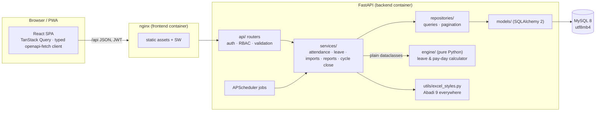

# ProsParity — Attendance, Leave & Pay-Days

A full-stack HR system for small and medium offices: fast daily attendance marking, Excel imports, leave
recording with an **immutable leave ledger**, probation-aware accruals, and an Accounts-ready **Salary Pay-Days
Report** (Excel in Abadi 9, PDF) with one-click cycle close.

> **This version is HR-only.** HR marks attendance and records leave for everyone; employees, managers and
> Accounts do not sign in. The self-service pages (`/me…`), approval inboxes and non-HR logins are kept in the
> codebase but commented out (search for "HR-only version"), and the backend still supports all four roles, so
> they can be switched back on later.

* **Backend:** Python 3.12 · FastAPI · SQLAlchemy 2 · Alembic · Pydantic v2 · pandas/openpyxl · reportlab · APScheduler · MySQL 8
* **Frontend:** React 18 · Vite · TypeScript · Tailwind · shadcn/ui (Radix) · Framer Motion · TanStack Query/Table/Virtual · React Hook Form + Zod · Recharts · cmdk · Sonner · PWA
* **Tests:** pytest (engine + services + API, runs on SQLite *and* MySQL) · Vitest + React Testing Library · Playwright

---

## Quick start (Docker)

```bash
cp .env.example .env          # optional – defaults work
docker compose up --build
```

| URL | What |
|---|---|
| http://localhost:8080 | Web app |
| http://localhost:8000/docs | OpenAPI / Swagger |

The backend container waits for MySQL, runs `alembic upgrade head`, seeds demo data (`SEED_DEMO=true`) and starts
the API + scheduler.

### Login (password `Demo@1234`)

| Role | Email | Name |
|---|---|---|
| HR Admin | `hr@prosparity.demo` | Shraddha Rajeshirke — full access: grid, imports, leave, cycle close, reports, audit, settings |

More HR users can be added in **Settings → Users & roles**.

Demo data: 25 employees in 6 departments, 4 salary cycles of attendance ending today (the two oldest locked),
probation and permanent staff, new joiners on 26 Oct and 1 Nov, an exit on 10 Nov, a confirmation mid-history,
past and upcoming leave recorded by HR, comp-offs and the 2026 holiday calendar.

## Free cloud deployment

Vercel (frontend) + Render (backend) + TiDB Cloud Starter (MySQL-compatible DB). Step by step in
[DEPLOY.md](DEPLOY.md).

## Local development (without Docker)

```bash
# backend
cd backend
python3.12 -m venv .venv && .venv/bin/pip install -r requirements.txt
cp .env.example .env                     # set DATABASE_URL (MySQL) – or use sqlite:///./storage/dev.db
.venv/bin/alembic upgrade head
.venv/bin/python -m app.seed             # --reset to start over
.venv/bin/uvicorn app.main:app --reload  # http://localhost:8000

# frontend
cd frontend
npm install
npm run dev                              # http://localhost:5173 (proxies /api to :8000)
npm run gen:api                          # regenerate the typed API client from the running backend
```

## Tests

```bash
cd backend && .venv/bin/pytest                       # SQLite in-memory
TEST_DATABASE_URL="mysql+pymysql://user:pw@localhost:3306/prosparity_test?charset=utf8mb4" .venv/bin/pytest

cd frontend && npm test                              # Vitest + RTL
cd frontend && npx playwright test                   # E2E (starts a seeded backend + Vite automatically)
```

---

## Architecture



```
backend/app
├── api/            routers (HTTP only)          ├── engine/       PURE leave & pay-day engine (no DB/IO)
├── services/       business workflows           ├── repositories/ query helpers, pagination
├── models/         SQLAlchemy models            ├── schemas/      Pydantic v2 request/response
├── core/           config, db, security, errors └── utils/        excel_styles, time
frontend/src
├── pages/          route pages                  ├── features/     page-specific components (attendance grid…)
├── components/ui   Radix/shadcn primitives      ├── components/shared  design-system pieces (rings, heatmap…)
├── lib/            api client, auth, theme, status registry   └── styles/index.css  design tokens
```

**Single source of truth for balances:** every change is an immutable row in `leave_ledger`
(ACCRUAL, PROBATION_LOCK, PROBATION_RELEASE, LEAVE_USED, LOP, ADJUSTMENT, CARRY_FORWARD, COMP_OFF_EARNED,
COMP_OFF_EXPIRED, ENCASHMENT) in buckets `usable`, `locked`, `comp_off` (+ informational `lop`). Balances are
`SUM(amount)`. Editing past attendance never overwrites history: the recalculator **reverses** the rows that no longer
hold and **posts** the new ones; re-running is a no-op.

## How the rules are calculated

For each employee and salary cycle the engine (`backend/app/engine/leave_engine.py`) walks the cycle day by day:

1. **Eligible window** = cycle ∩ [date of joining, exit date]. Days outside show as `NJ` / `EX`.
2. **Accrual** 1.5 on the first eligible day (pro-rata `1.5 × eligible ÷ cycle days`, nearest 0.5, for joiners and
   leavers). On probation: 0.5 → usable, 1.0 → locked.
3. **Confirmation date** reached → the whole locked bucket is released to usable (`PROBATION_RELEASE`).
4. **Each day:** Sundays/holidays are paid (`WO`/`H`); `P`/`WFH`/`OD` present; `HD` = 0.5 present + 0.5 deduction;
   `A`/`L` = 1.0 deduction; `CO` = 1.0 from comp-off first. A deduction takes **usable → LOP** (locked is never
   touched). Working a Sunday/holiday earns a comp-off (expires in 60 days).
5. **Payable days = eligible − LOP.** Salary amounts are calculated by Accounts from these day counts.

All defaults and optional rules (sandwich, late marks, negative balance, daily accrual…) are in
[DECISIONS.md](DECISIONS.md) and editable in **Settings**.

### Worked examples (all are automated tests — `backend/tests/test_engine.py`, `test_services.py`)

Cycle **20 Oct – 19 Nov 2026**: 31 days, Sundays 25 Oct, 1, 8, 15 Nov.

| # | Scenario | Result |
|---|---|---|
| 1 | Permanent, opening usable 1.0, accrual +1.5 = 2.5; 3 × A + 1 × HD (needs 3.5) | 2.5 paid leave, **1.0 LOP**, closing usable 0, **payable 30** |
| 2 | Probation, cumulative OFF: accrual 0.5 usable + 1.0 locked; 2 × A | **0.5 paid, 1.5 LOP**, payable 29.5, locked 1.0 untouched |
| 3 | Probation for 3 cycles (locked 3.0), confirmed 20 Oct | `PROBATION_RELEASE` −3.0 locked / +3.0 usable on 20 Oct |
| 4 | New joiner, DOJ 1 Nov | eligible 19 (1–19 Nov), accrual 1.5×19/31 = 0.92 → **1.0**, payable 19 |
| 5 | Holiday inside the cycle marked `H` | not deducted, paid; payable 31 |
| 6 | Exit 10 Nov | eligible **22**, remark "x leave balance pending encashment", encashment preview & posting |
| 7 | Retro edit A→P | locked cycle → **blocked (HTTP 423)**; open cycle → reversal row (`reversal_of_id`) + re-post, balance restored, second recalculation writes 0 rows |

## Loading HR's legacy payable-days sheets

The dev database was loaded from HR's own monthly workbooks ("Payable Days Calculation - <Month> <Year>.xlsx").
To reload (this **replaces all data**; HR login stays `hr@prosparity.demo` / `Demo@1234`):

```bash
cd backend
.venv/bin/python -m app.importers.load_legacy --reset \
  --sheet 2026-09-19="/path/Payable Days Calculation - Sept 2026 (2).xlsx" \
  --sheet 2026-10-19="/path/Payable Days Calculation - Oct 2026.xlsx"
```

Each `--sheet` is `<cycle end date>=<file>`. Only the data (employees, DOJ, exits, marks, holidays, the first
sheet's "Leaves in Hand" as opening balances) is used; every cycle is calculated with ProsParity's own leave rules
and the sheet months are then locked. `python -m app.seed --reset` still
restores the demo data (used by the E2E tests). See DECISIONS.md → "Real data".

## Importing attendance from Excel

1. **Excel import → Download template** (wide or long) for the selected cycle, or use your own file.
2. Drop an `.xlsx`, `.xls` or `.csv` file. The wizard auto-detects the header row, the employee-code column and the
   layout:
   * **Wide** — one row per employee, one column per date (`Emp Code | Name | 20-Oct-2026 | 21-Oct-2026 …`).
     Headers can be real dates, `20-Oct`, `2026-10-20`, `20/10/2026` or bare day numbers (pick the cycle).
   * **Long** — one row per employee-day (`Emp Code | Date | Status | Note`).
3. **Map columns** (editable; save the mapping as a reusable template). Status aliases such as `Present`, `Absent`,
   `Half day`, `CL/SL/PL/EL`, `W/O`, `PH`, `C/O`, `1`/`0` are understood; add your own per import.
4. **Validation preview** highlights each cell: unknown employee code, invalid status, date outside employment,
   duplicates, future dates, locked cycles (errors — skipped) and overwrites / leave on a Sunday (warnings —
   imported). Download the problem rows as Excel.
5. **Confirm** — valid rows are written (`source=import`), affected cycles are recalculated, and the batch appears in
   the import history, where it can be **rolled back** as a whole (marks changed after the import are kept).

Status codes: `P` Present · `A` Absent · `HD` Half-day · `L` Leave · `WO` Weekly off · `H` Holiday ·
`CO` Comp-off · `WFH` Work from home · `OD` On duty · `NJ` Not joined · `EX` Exited (the last two are automatic).

## Reports

All Excel files share one style helper (`backend/app/utils/excel_styles.py`): Abadi 9 throughout, bold light-filled
header, frozen panes, auto-filter, fitted widths, `0.0` days, title block and `=SUM()` totals.

* **Salary Pay-Days Report** (xlsx/pdf) — one row per employee with every column Accounts needs.
* **Muster roll** — day-wise codes with `COUNTIF` totals.
* **Leave register** — ledger entries in the cycle + balances sheet.
* **LOP summary** — per employee and per department.
* **Employee monthly statement** — PDF and Excel, downloaded by HR from the reports page or an employee profile.
* **Email to Accounts** — sends xlsx + pdf (dev mode writes `.eml` files to `backend/storage/outbox/`).

## Using it

* **Daily marking:** *Attendance* → *Mark all present* → tap exceptions. Click a cell for the radial picker, or use
  the keyboard: arrows to move, `P A D L W H C F O` to set, `Shift`+click / `Shift`+arrows for ranges, `Del` to clear,
  click a date header to select the whole day. Every change auto-saves with an **Undo** toast.
* **Cycle close:** *Cycle close & reports* → run checks (unmarked days, pending approvals, anomalies) → preview →
  lock. HR can unlock with a reason (audited).
* **Command palette:** `⌘K` / `Ctrl+K` — jump to an employee, mark everyone present, download the pay-days report.

See [DECISIONS.md](DECISIONS.md) for every assumption and default.
